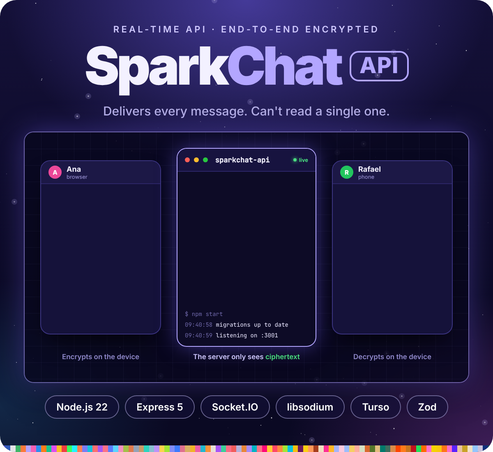
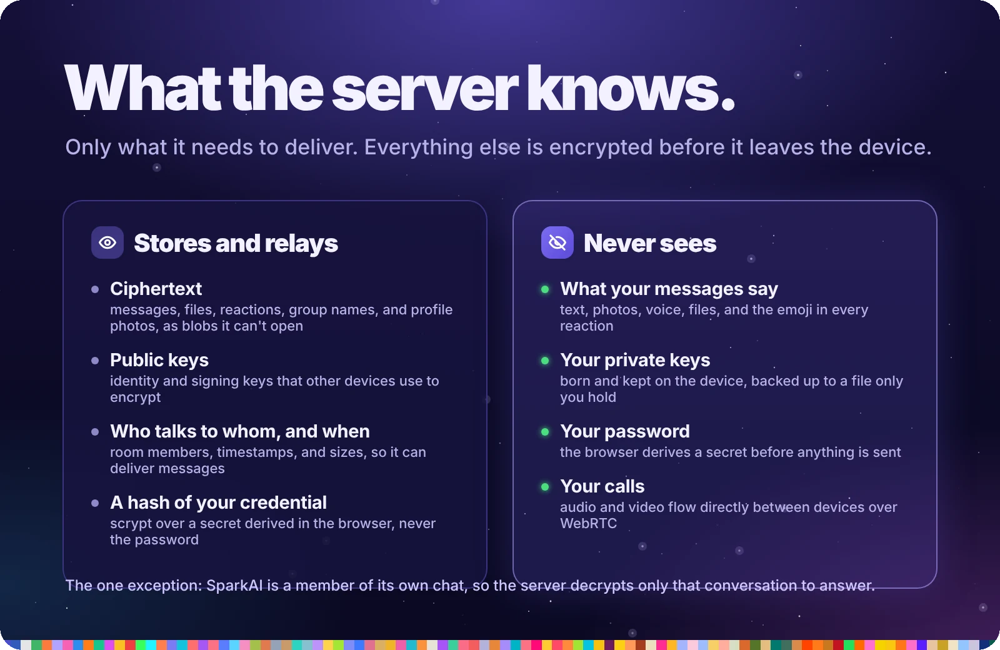
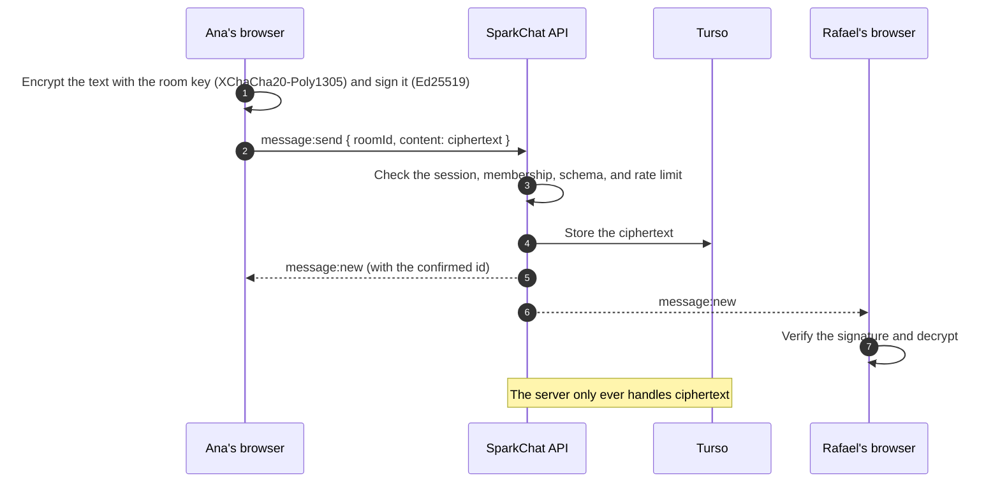
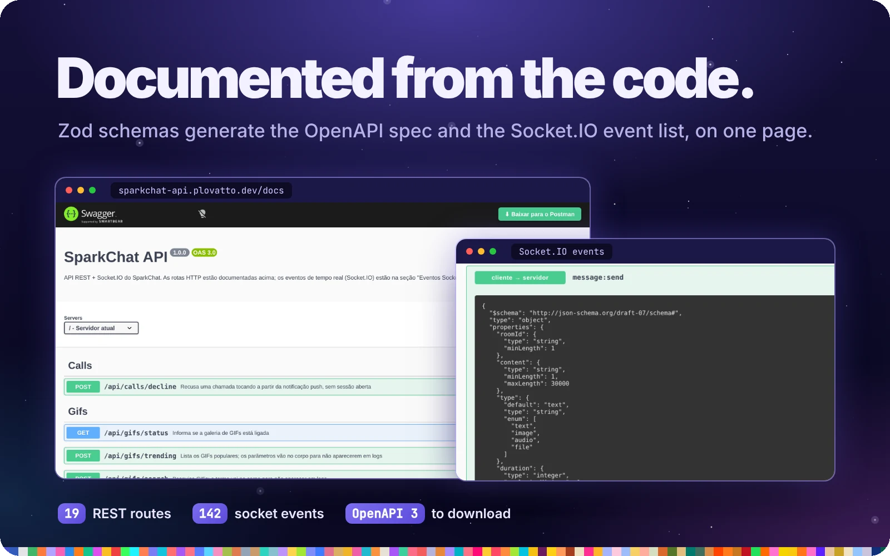
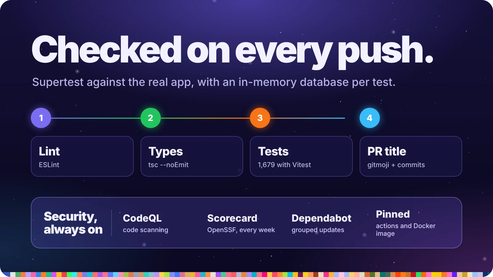

<div align="center">
  <a href="https://sparkchat-api.plovatto.dev/docs/">
    <picture>
      <source media="(prefers-reduced-motion: reduce)" srcset="./.github/assets/hero-still-en.webp">
      
    </picture>
  </a>

  <br>
  <br>

<a href="https://sparkchat-api.plovatto.dev/docs/"></a>
&nbsp;
<a href="https://sparkchat.plovatto.dev/en/"></a>
&nbsp;
<a href="README.pt-BR.md"></a>

  <br>
  <br>

<a href="https://github.com/Plovatto/API-SparkChat/actions/workflows/ci.yml"></a>
<a href="https://github.com/Plovatto/API-SparkChat/actions/workflows/docker.yml"></a>
<a href="https://scorecard.dev/viewer/?uri=github.com/Plovatto/API-SparkChat"></a>
<a href="https://www.bestpractices.dev/projects/16065"></a>
<a href="LICENSE"></a>
</div>

<br>

<p align="center">The SparkChat API is the server behind <a href="https://sparkchat.plovatto.dev/en/">SparkChat</a>, a real-time chat with end-to-end encryption. It handles accounts, rooms, message delivery, uploads, and call signaling, while messages, files, and keys are encrypted in the browser before they reach it. This repository is the server. The web client lives in <a href="https://github.com/Plovatto/SparkChat">SparkChat</a>.</p>

<p align="center"></p>

<details>
<summary><strong>Table of contents</strong></summary>

- [What the server knows](#what-the-server-knows)
- [Architecture](#architecture)
- [How a message travels](#how-a-message-travels)
- [Features](#features)
- [API at a glance](#api-at-a-glance)
- [Security](#security)
- [Quality](#quality)
- [Getting started](#getting-started)
- [Configuration](#configuration)
- [Limits](#limits)
- [Real-time connection](#real-time-connection)
- [Scripts](#scripts)
- [Project structure](#project-structure)
- [Deployment](#deployment)
- [Contributing](#contributing)
- [Reporting vulnerabilities](#reporting-vulnerabilities)
- [Changelog](#changelog)
- [Author](#author)
- [License](#license)

</details>

## What the server knows

The API is designed to know as little as possible: enough to deliver each message, and nothing about what it says.



## Architecture


## How a message travels



Files follow the same path: the browser encrypts them, uploads the ciphertext to `/api/messages/upload-*`, and sends the returned URL inside an encrypted message.

## Features

<table>
  <tr>
    <td width="50%" valign="top">
      <p><br><strong>Real time</strong><br>142 typed Socket.IO events for messages, presence, typing and recording indicators, and read receipts, with session recovery after short disconnections.</p>
      <br>
      <p><br><strong>Call signaling</strong><br>Voice and video calls with signed signaling, Cloudflare TURN credentials, call transfer between devices, and Web Push for incoming calls.</p>
      <br>
      <p><br><strong>Encrypted media</strong><br>Photos, voice messages, files, avatars, and GIFs stored on Cloudflare R2 as ciphertext, with size limits, a storage quota, and byte checks for anything unencrypted.</p>
    </td>
    <td width="50%" valign="top">
      <p><br><strong>Keys and sessions</strong><br>Public key directory, room keys sealed for each member and rotated when someone leaves, and sessions bound to a device key.</p>
      <br>
      <p><br><strong>SparkAI</strong><br>An assistant powered by Google Gemini that joins its own encrypted chat, reads photos, voice, and PDFs, and has daily usage limits.</p>
      <br>
      <p><br><strong>Key transparency</strong><br>An optional append-only Merkle log of account keys, with signed heads, inclusion and consistency proofs, and an external witness.</p>
    </td>
  </tr>
</table>

## API at a glance

Every route and socket event is described with Zod, and the docs are generated from those schemas. The live docs are at [sparkchat-api.plovatto.dev/docs](https://sparkchat-api.plovatto.dev/docs/), and the OpenAPI spec can be downloaded from [`/docs/download`](https://sparkchat-api.plovatto.dev/docs/download).



REST is used for what doesn't fit a socket: sign-in, binary uploads, and proxies. Everything else goes through Socket.IO.

| Group         | Routes                                                                                                                     |
| :------------ | :------------------------------------------------------------------------------------------------------------------------- |
| System        | `GET /health`                                                                                                              |
| Users         | `POST /api/users/auth-params`, `login`, `login-with-recovery`, `logout`, `session/device-key`, `GET nickname-availability` |
| Messages      | `POST /api/messages/upload-image`, `upload-audio`, `upload-file`, `upload/gif`                                             |
| Avatars       | `POST /api/avatars/upload`                                                                                                 |
| Link previews | `POST /api/link-preview`, `POST /api/link-preview/image`                                                                   |
| GIFs          | `GET /api/gifs/status`, `POST /api/gifs/trending`, `search`, `media`                                                       |
| Calls         | `POST /api/calls/decline`, to decline from a notification without an open session                                          |

<details>
<summary>Socket.IO events by module</summary>

| Module           | Events | Examples                                                                                  |
| :--------------- | -----: | :---------------------------------------------------------------------------------------- |
| Rooms            |     37 | `room:create-group`, `room:join-by-invite`, `e2e:share-room-key`, `e2e:rotation-required` |
| Users            |     31 | `user:join`, `user:list-sessions`, `user:revoke-session`, `e2e:get-public-keys`           |
| Calls            |     24 | `call:start`, `call:signal`, `call:ice-servers`, `call:transfer`                          |
| Messages         |     23 | `message:send`, `message:react`, `typing:start`, `message:read-receipt`                   |
| Key transparency |     11 | `kt:get-head`, `kt:get-proofs`, `kt:get-consistency`, `kt:audit`                          |
| Avatars          |      9 | `user:set-avatar`, `room:set-avatar`, `room:publish-profile-key`                          |
| Push             |      6 | `push:config`, `push:subscribe`, `push:unsubscribe`                                       |

The full list, with the payload schema of each event, is at [`/docs/socket-events.json`](https://sparkchat-api.plovatto.dev/docs/socket-events.json) and in the Socket.IO events section of the docs page.

</details>

Try it from a terminal:

```bash
curl https://sparkchat-api.plovatto.dev/health
# {"status":"ok","uptime":...}

curl "https://sparkchat-api.plovatto.dev/api/users/nickname-availability?nickname=ada"
# {"status":"available"} or {"status":"taken"}
```

Errors always carry a stable `code`, such as `auth.required` or `rateLimit.api`, that clients translate.

## Security


<details>
<summary>Where each protection lives</summary>

| Protection                                   | Code                                                                                                                                                                    |
| :------------------------------------------- | :---------------------------------------------------------------------------------------------------------------------------------------------------------------------- |
| Client-derived credentials and fake salts    | [`user.credentials.ts`](src/modules/users/user.credentials.ts)                                                                                                          |
| scrypt hashing with a concurrency gate       | [`user.password.ts`](src/modules/users/user.password.ts)                                                                                                                |
| Device-bound sessions and request signatures | [`user.session-signature.ts`](src/modules/users/user.session-signature.ts), [`user.device.ts`](src/modules/users/user.device.ts)                                        |
| Room key envelopes and rotation              | [`room.key-envelope.ts`](src/modules/rooms/room.key-envelope.ts), [`room.rotation.ts`](src/modules/rooms/room.rotation.ts)                                              |
| Key transparency log                         | [`src/modules/transparency`](src/modules/transparency), explained in [`docs/key-transparency.md`](docs/key-transparency.md) (in Portuguese)                             |
| Upload checks by file signature              | [`message.file-signature.ts`](src/modules/messages/message.file-signature.ts), [`message.upload.ts`](src/modules/messages/message.upload.ts)                            |
| SSRF guard for link previews                 | [`link-preview.ssrf-guard.ts`](src/modules/link-preview/link-preview.ssrf-guard.ts)                                                                                     |
| HTTP and socket rate limits                  | [`rate-limit.ts`](src/middleware/rate-limit.ts), [`socket-rate-limit.ts`](src/sockets/socket-rate-limit.ts), [`connection-limits.ts`](src/sockets/connection-limits.ts) |
| Log redaction                                | [`app.ts`](src/app.ts), [`request-log.ts`](src/config/request-log.ts)                                                                                                   |

</details>

> [!IMPORTANT]
> This software uses cryptography. Its import, use, or export may be restricted in some countries. Check the laws where you run it.

## Quality



<details>
<summary>How each check works</summary>

- [`ci.yml`](.github/workflows/ci.yml) runs lint, the type check, the tests, and the build on every push and pull request to `main`.
- [`docker.yml`](.github/workflows/docker.yml) builds the image, starts it with throwaway keys, and checks `/health` and the OpenAPI spec.
- [`pr-title.yml`](.github/workflows/pr-title.yml) checks that pull request titles follow the gitmoji and Conventional Commits format.
- Route tests use [Supertest](https://github.com/ladjs/supertest) against `createApp` without opening a port, and every test gets an isolated in-memory libSQL database from [`test/support`](test/support). Property-based tests use [fast-check](https://fast-check.dev/).
- [CodeQL](https://github.com/Plovatto/API-SparkChat/security/code-scanning) scans the code, the [OpenSSF Scorecard](https://scorecard.dev/viewer/?uri=github.com/Plovatto/API-SparkChat) runs every week, and Dependabot groups dependency updates.

</details>

## Getting started

Requires [Node.js](https://nodejs.org/) 20 or newer (CI uses the version in [`.nvmrc`](.nvmrc)) and npm. For production you also need a [Turso](https://turso.tech/) database, a [Cloudflare R2](https://developers.cloudflare.com/r2/) bucket, and a [Gemini API key](https://ai.google.dev/). For local development, a libSQL file works as the database.

1. Clone the repository and install the dependencies:

   ```bash
   git clone https://github.com/Plovatto/API-SparkChat.git
   cd API-SparkChat
   npm install
   ```

2. Copy the environment file:

   ```bash
   cp .env.example .env
   ```

3. Fill in the required variables. For a local database, use `TURSO_DATABASE_URL=file:local.db` and any value for `TURSO_AUTH_TOKEN`. These commands generate the secrets:

   ```bash
   npm run ai:keygen            # prints AI_ASSISTANT_PRIVATE_KEY
   openssl rand -hex 32         # a value for RECOVERY_FILE_SECRET
   ```

4. Start the server. Migrations run on startup, and the API listens on <http://localhost:3001>:

   ```bash
   npm run dev
   curl http://localhost:3001/health
   ```

The docs open at <http://localhost:3001/docs>. To use the API with the interface, run the [web client](https://github.com/Plovatto/SparkChat) with `VITE_API_URL=http://localhost:3001`.

<details>
<summary>Run with Docker</summary>

```bash
docker build --tag sparkchat-api .
docker run --env-file .env --env PORT=8080 --publish 8080:8080 sparkchat-api
```

The image is a multi-stage build on a pinned `node:22-slim`, with only production dependencies, the compiled `dist`, and the migrations.

</details>

## Configuration

Variables are read from `.env` and validated with Zod on startup, so the API refuses to start with a missing or invalid value. Use [`.env.example`](.env.example) as a reference.

| Required variable          | Description                                                                  |
| :------------------------- | :--------------------------------------------------------------------------- |
| `TURSO_DATABASE_URL`       | Database URL, such as `libsql://...` or `file:local.db`                      |
| `TURSO_AUTH_TOKEN`         | Database token                                                               |
| `RECOVERY_FILE_SECRET`     | At least 32 characters. Server secret used for recovery files and fake salts |
| `GEMINI_API_KEY`           | Google Gemini key for SparkAI                                                |
| `AI_ASSISTANT_PRIVATE_KEY` | SparkAI's encryption key, generated with `npm run ai:keygen`                 |
| `R2_ACCOUNT_ID`            | Cloudflare account id                                                        |
| `R2_ACCESS_KEY_ID`         | R2 access key                                                                |
| `R2_SECRET_ACCESS_KEY`     | R2 secret key                                                                |
| `R2_BUCKET_NAME`           | Bucket for uploaded files                                                    |
| `R2_PUBLIC_BASE_URL`       | Public URL of the bucket                                                     |

| Optional variable                                                             | Default                 | Description                                                   |
| :---------------------------------------------------------------------------- | :---------------------- | :------------------------------------------------------------ |
| `NODE_ENV`                                                                    | `development`           | `development`, `test`, or `production`                        |
| `PORT`                                                                        | `3001`                  | HTTP port                                                     |
| `FRONTEND_URL`                                                                | `http://localhost:5173` | Origin allowed by CORS and Socket.IO                          |
| `LOG_LEVEL`                                                                   | `info`                  | Pino log level                                                |
| `TRUST_PROXY_HOPS`                                                            | `0`                     | Number of reverse proxies in front of the API                 |
| `SESSION_SIGNATURE_MODE`                                                      | `bound`                 | `bound` or `required`                                         |
| `PASSWORD_SCRYPT_COST`                                                        | `65536`                 | scrypt cost, a power of two up to `131072`                    |
| `PASSWORD_LENGTH_DECLARATION_REQUIRED`                                        | `false`                 | Requires clients to declare the password length on sign-up    |
| `CLOUDFLARE_TURN_KEY_ID`, `CLOUDFLARE_TURN_API_TOKEN`                         |                         | TURN relay for calls. Set both or neither                     |
| `WEB_PUSH_VAPID_PUBLIC_KEY`, `WEB_PUSH_VAPID_PRIVATE_KEY`, `WEB_PUSH_SUBJECT` |                         | Web Push notifications. Set all three or none                 |
| `KLIPY_API_KEY`                                                               |                         | Turns on the GIF gallery                                      |
| `GIF_PROVIDER`                                                                | `klipy`                 | `klipy`, or `fake` for local tests                            |
| `KEY_TRANSPARENCY_ENABLED`                                                    | `false`                 | Turns on the key transparency log                             |
| `KT_LOG_SIGNING_KEY`                                                          |                         | Log signing key, required in production when the log is on    |
| `KT_WITNESS_*`                                                                |                         | Publishes the signed head to a GitHub repository or a webhook |

<details>
<summary>Calls, push, and GIFs</summary>

- **TURN.** `CLOUDFLARE_TURN_KEY_ID` and `CLOUDFLARE_TURN_API_TOKEN` turn on Cloudflare Realtime TURN credentials for voice and video calls. Without them, calls only use STUN and no relay is available.
- **Web Push.** `WEB_PUSH_VAPID_PUBLIC_KEY`, `WEB_PUSH_VAPID_PRIVATE_KEY`, and `WEB_PUSH_SUBJECT` turn on notifications while the app is closed (incoming call, call ended, and new message). Without them, the feature is off: `push:config` answers `{ enabled: false, publicKey: null }`, `push:subscribe` is refused, and nothing is sent. The keys are a P-256 VAPID pair in base64url (`npx web-push generate-vapid-keys`), and the subject is a `mailto:` address or an `https:` contact URL. Notifications carry only opaque ids (`callId`, `roomId`), never names, content, or keys, and are only sent to known push services.
- **GIFs.** `KLIPY_API_KEY` turns on the GIF gallery with the KLIPY API. Without it, `GET /api/gifs/status` answers `enabled: false`. `GIF_PROVIDER=fake` is a deterministic provider for tests and local end-to-end runs, and the API refuses to start with it when `NODE_ENV=production`.

</details>

<details>
<summary>Sessions, passwords, and proxies</summary>

- **Device binding.** The client creates a non-exportable ECDSA P-256 key pair, registers the public key on the session, and signs each authenticated request and `user:join` (method, path, time, nonce, and body hash). With `SESSION_SIGNATURE_MODE=bound`, only sessions that already have a key must sign, and older sessions keep working until they register one. With `required`, every session without a key is refused and has to sign in again; turn it on only after updated clients have migrated their sessions. While in `bound` mode, someone who already holds an old session's token could register their own key first, and the legitimate client then gets a 409 and is asked to sign in again. Nonces are kept in memory, so replay protection is per instance and is lost on restart (the window is 5 minutes).
- **Password cost.** `PASSWORD_SCRYPT_COST` is the scrypt cost for password hashes. Each sign-in uses about 128 times the value in bytes of memory (64 MB with the default), so raise it only if the host has memory to spare for concurrent sign-ins.
- **Reverse proxies.** `TRUST_PROXY_HOPS` is the number of reverse proxies in front of the API, for example `1` behind a hosting load balancer. With the right value, rate limits use each user's IP instead of the proxy's. Keep `0` when the API receives connections directly.

</details>

<details>
<summary>Key transparency</summary>

`KEY_TRANSPARENCY_ENABLED` turns on an append-only Merkle log of each account's identity and signing keys, which authenticated sessions query over the socket (`kt:*`). In production it requires `KT_LOG_SIGNING_KEY`, generated with `npm run kt:keygen`. With the flag off, nothing changes. The optional `KT_WITNESS_*` variables publish only the signed head to a GitHub repository or a webhook. The rollout, backup, and witness steps are in [`docs/key-transparency.md`](docs/key-transparency.md) (in Portuguese).

</details>

## Limits

| What                     | Limit                                                         |
| :----------------------- | :------------------------------------------------------------ |
| Images, voice, and files | 5 MB, 8 MB, and 50 MB per upload                              |
| Encrypted GIFs           | Padded to fixed sizes up to 2 MB, deleted after 30 days       |
| Storage                  | 8 GB in total, enforced by the service itself                 |
| REST requests            | 300 per minute per IP on `/api`, with stricter sign-in limits |
| Socket connections       | 100 per IP and 10 per user                                    |
| Message size             | 30,000 characters of ciphertext                               |

## Real-time connection

Socket.IO accepts the `websocket` and `polling` transports, only from the origin in `FRONTEND_URL`, with credentials. It sends a ping every 20 seconds and tolerates 25 seconds without an answer, so short network drops don't end the connection. With `connectionStateRecovery`, a client that reconnects within 5 minutes, such as a phone coming back from the background, gets its session and rooms back. Large frames are compressed with per-message deflate.

## Scripts

| Command               | Description                                    |
| :-------------------- | :--------------------------------------------- |
| `npm run dev`         | Starts the server in watch mode                |
| `npm run build`       | Compiles TypeScript to `dist`                  |
| `npm start`           | Runs the compiled API                          |
| `npm run typecheck`   | Runs the type check without emitting files     |
| `npm run lint`        | Runs ESLint                                    |
| `npm run lint:fix`    | Fixes lint problems automatically              |
| `npm test`            | Runs the tests                                 |
| `npm run test:watch`  | Runs the tests in watch mode                   |
| `npm run db:generate` | Generates a migration from the Drizzle schema  |
| `npm run ai:keygen`   | Generates SparkAI's encryption key             |
| `npm run kt:keygen`   | Generates the key transparency log signing key |

## Project structure

<details>
<summary>View the folder tree</summary>

```text
src/
├── app.ts             # Builds the Express app (used in production and in tests)
├── server.ts          # Entry point: creates the app and Socket.IO, and starts the server
├── config/            # Environment variables, logger, and request log scrubbing
├── database/          # Drizzle schema, Turso/libSQL client, and migrations
├── docs/              # OpenAPI registry, Socket.IO event registry, and the /docs page
├── lib/               # Shared helpers (errors, locale, sliding window counter)
├── middleware/        # Authentication, rate limits, async wrapper, and HTTP errors
├── modules/
│   ├── ai/            # SparkAI (E2E identity, Gemini provider, limits, and replies)
│   ├── avatars/       # Encrypted profile and group photos
│   ├── calls/         # Call signaling, TURN credentials, transfers, and limits
│   ├── gifs/          # GIF gallery (KLIPY provider, fake provider, thumbnail proxy)
│   ├── link-preview/  # Link previews (SSRF-guarded fetch, cache, and image proxy)
│   ├── messages/      # Messages, uploads, presence, typing, and recording
│   ├── push/          # Web Push subscriptions and delivery
│   ├── rooms/         # Private chats and groups, room keys, invites, and rotation
│   ├── transparency/  # Key transparency log, proofs, and witness
│   └── users/         # Accounts, sessions, device keys, recovery file, and user keys
├── routes/            # Mounts each module's routes under /api
├── sockets/           # Socket.IO contracts, sessions, limits, and connection registry
└── storage/           # R2 object storage, quota, upload registry, and sweepers

drizzle/               # SQL migrations, applied on startup
scripts/               # Key generation scripts
docs/                  # Key transparency guide
test/
├── support/           # Test helpers (app and services with an isolated in-memory database)
└── *.test.ts          # Unit, route, and socket tests for each module
```

</details>

## Deployment

<details>
<summary>How to deploy the API</summary>

The repository includes a multi-stage [`Dockerfile`](Dockerfile), so the API runs on any platform that runs containers, without relying on language detection.

The image exposes port `8080`, but the server listens on the port in `PORT`, so configure the platform so both match. Every required variable must be set in the runtime environment, and `FRONTEND_URL` must be the web client's origin (for example, `https://sparkchat.plovatto.dev`).

Migrations run automatically when the server starts. The published API is served at `sparkchat-api.plovatto.dev`.

</details>

## Contributing

Issues and pull requests are welcome. Read the [contributing guide](CONTRIBUTING.md) for the branch, commit, test, and pull request conventions, and follow the [code of conduct](CODE_OF_CONDUCT.md).

## Reporting vulnerabilities

Please do not open public issues for vulnerabilities. Report them privately as described in the [security policy](SECURITY.md).

## Changelog

Notable changes are recorded in the [changelog](CHANGELOG.md), and each version is published on the [releases page](https://github.com/Plovatto/API-SparkChat/releases).

## Author

**Pandora Becker Lovatto** · [@Plovatto](https://github.com/Plovatto) · [plovatto.dev](https://plovatto.dev/en/)

## License

Distributed under the [MIT License](LICENSE).

<br>

<p align="center"></p>

<p align="center"><a href="#readme"></a></p>
