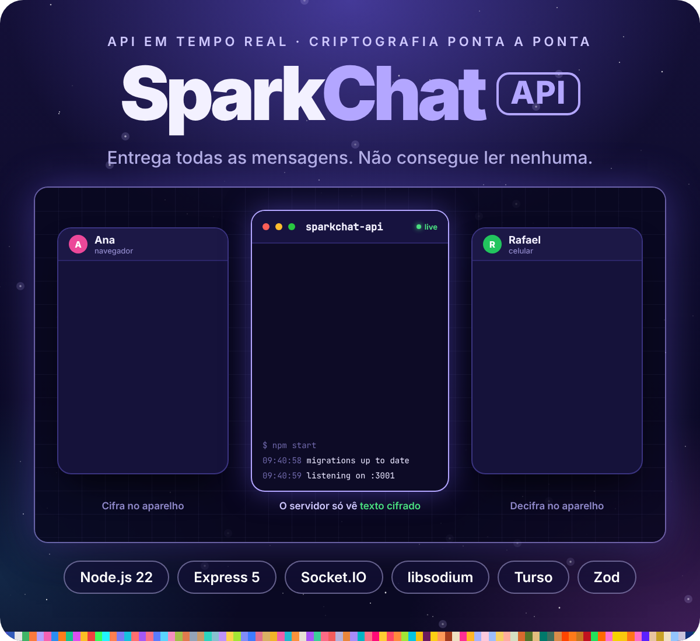
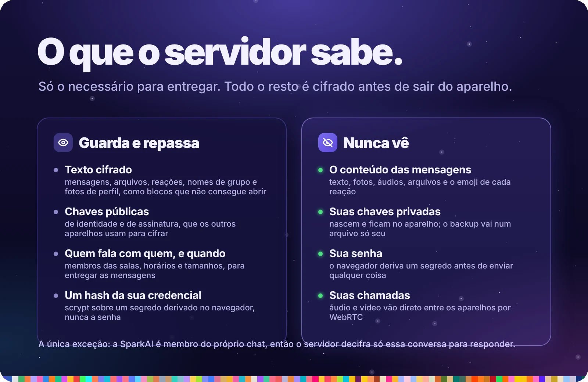
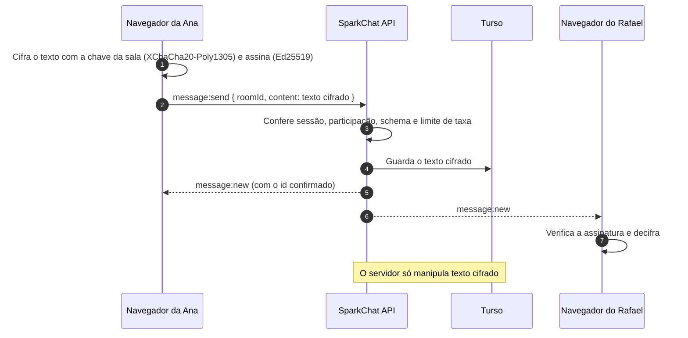
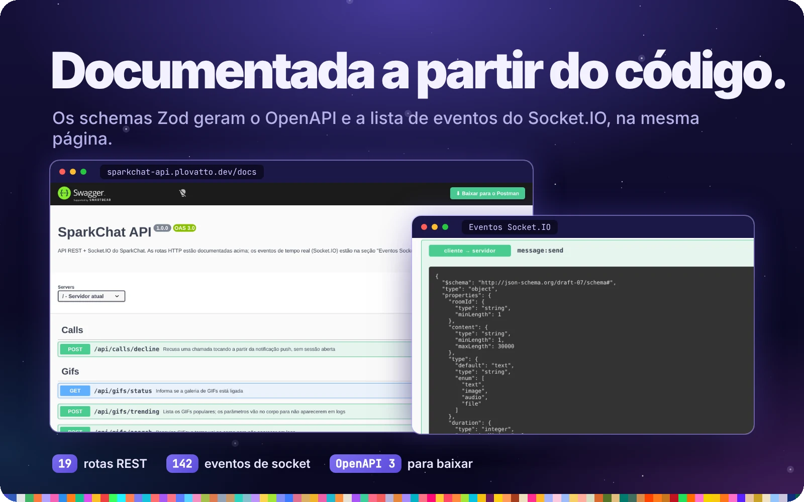
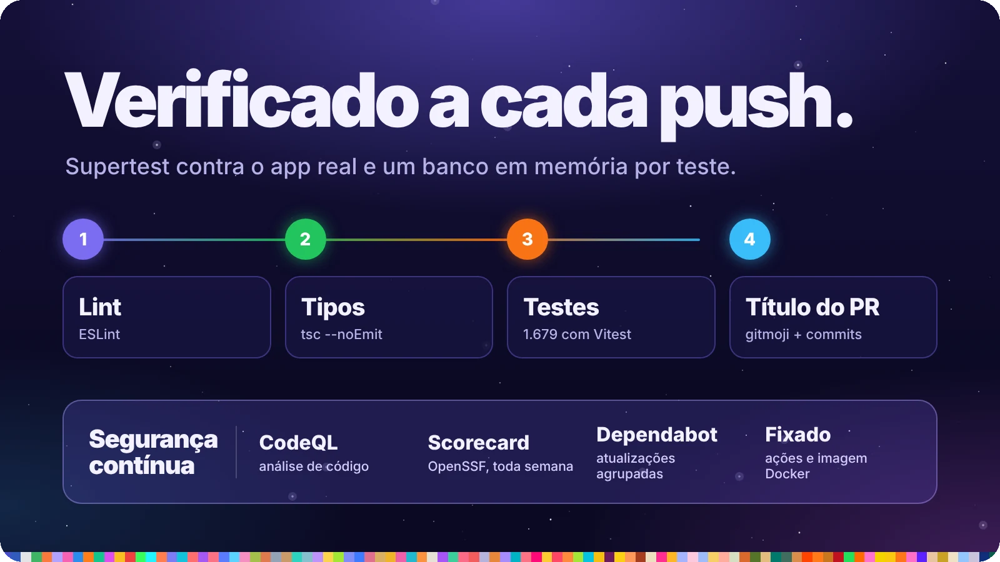

<div align="center">
  <a href="https://sparkchat-api.plovatto.dev/docs/">
    <picture>
      <source media="(prefers-reduced-motion: reduce)" srcset="./.github/assets/hero-still-pt.webp">
      
    </picture>
  </a>

  <br>
  <br>

<a href="https://sparkchat-api.plovatto.dev/docs/"></a>
&nbsp;
<a href="https://sparkchat.plovatto.dev/"></a>
&nbsp;
<a href="README.md"></a>

  <br>
  <br>

<a href="https://github.com/Plovatto/API-SparkChat/actions/workflows/ci.yml"></a>
<a href="https://github.com/Plovatto/API-SparkChat/actions/workflows/docker.yml"></a>
<a href="https://scorecard.dev/viewer/?uri=github.com/Plovatto/API-SparkChat"></a>
<a href="https://www.bestpractices.dev/projects/16065"></a>
<a href="LICENSE"></a>
</div>

<br>

<p align="center">A SparkChat API é o servidor por trás do <a href="https://sparkchat.plovatto.dev/">SparkChat</a>, um chat em tempo real com criptografia de ponta a ponta. Ela cuida de contas, salas, entrega de mensagens, uploads e sinalização de chamadas, enquanto mensagens, arquivos e chaves são cifrados no navegador antes de chegar até ela. Este repositório é o servidor. O cliente web fica em <a href="https://github.com/Plovatto/SparkChat">SparkChat</a>.</p>

<p align="center"></p>

<details>
<summary><strong>Sumário</strong></summary>

- [O que o servidor sabe](#o-que-o-servidor-sabe)
- [Arquitetura](#arquitetura)
- [Como uma mensagem viaja](#como-uma-mensagem-viaja)
- [Funcionalidades](#funcionalidades)
- [A API em resumo](#a-api-em-resumo)
- [Segurança](#segurança)
- [Qualidade](#qualidade)
- [Como executar](#como-executar)
- [Configuração](#configuração)
- [Limites](#limites)
- [Conexão em tempo real](#conexão-em-tempo-real)
- [Scripts](#scripts)
- [Estrutura do projeto](#estrutura-do-projeto)
- [Deploy](#deploy)
- [Como contribuir](#como-contribuir)
- [Como relatar vulnerabilidades](#como-relatar-vulnerabilidades)
- [Changelog](#changelog)
- [Autora](#autora)
- [Licença](#licença)

</details>

## O que o servidor sabe

A API foi pensada para saber o mínimo possível: o suficiente para entregar cada mensagem, e nada sobre o que ela diz.



## Arquitetura


## Como uma mensagem viaja



Arquivos seguem o mesmo caminho: o navegador cifra, envia o texto cifrado para `/api/messages/upload-*` e manda a URL devolvida dentro de uma mensagem cifrada.

## Funcionalidades

<table>
  <tr>
    <td width="50%" valign="top">
      <p><br><strong>Tempo real</strong><br>142 eventos tipados de Socket.IO para mensagens, presença, indicadores de digitação e gravação e confirmação de leitura, com recuperação da sessão após quedas curtas.</p>
      <br>
      <p><br><strong>Sinalização de chamadas</strong><br>Chamadas de voz e vídeo com sinalização assinada, credenciais TURN do Cloudflare, transferência entre aparelhos e Web Push para chamadas recebidas.</p>
      <br>
      <p><br><strong>Mídia cifrada</strong><br>Fotos, áudios, arquivos, fotos de perfil e GIFs guardados no Cloudflare R2 como texto cifrado, com limites de tamanho, cota de armazenamento e conferência dos bytes do que não for cifrado.</p>
    </td>
    <td width="50%" valign="top">
      <p><br><strong>Chaves e sessões</strong><br>Diretório de chaves públicas, chaves de sala seladas para cada membro e trocadas quando alguém sai, e sessões presas a uma chave do aparelho.</p>
      <br>
      <p><br><strong>SparkAI</strong><br>Uma assistente com Google Gemini que participa do próprio chat cifrado, lê fotos, áudios e PDFs e tem limites diários de uso.</p>
      <br>
      <p><br><strong>Transparência de chaves</strong><br>Um registro opcional, somente de acréscimo, das chaves de cada conta em árvore de Merkle, com cabeças assinadas, provas de inclusão e de consistência e uma testemunha externa.</p>
    </td>
  </tr>
</table>

## A API em resumo

Cada rota e cada evento de socket são descritos com Zod, e a documentação é gerada a partir desses schemas. A documentação no ar fica em [sparkchat-api.plovatto.dev/docs](https://sparkchat-api.plovatto.dev/docs/), e o OpenAPI pode ser baixado em [`/docs/download`](https://sparkchat-api.plovatto.dev/docs/download).



O REST fica com o que não cabe num socket: login, uploads binários e proxies. Todo o resto passa pelo Socket.IO.

| Grupo           | Rotas                                                                                                                      |
| :-------------- | :------------------------------------------------------------------------------------------------------------------------- |
| Sistema         | `GET /health`                                                                                                              |
| Usuários        | `POST /api/users/auth-params`, `login`, `login-with-recovery`, `logout`, `session/device-key`, `GET nickname-availability` |
| Mensagens       | `POST /api/messages/upload-image`, `upload-audio`, `upload-file`, `upload/gif`                                             |
| Fotos de perfil | `POST /api/avatars/upload`                                                                                                 |
| Prévia de links | `POST /api/link-preview`, `POST /api/link-preview/image`                                                                   |
| GIFs            | `GET /api/gifs/status`, `POST /api/gifs/trending`, `search`, `media`                                                       |
| Chamadas        | `POST /api/calls/decline`, para recusar pela notificação sem sessão aberta                                                 |

<details>
<summary>Eventos de Socket.IO por módulo</summary>

| Módulo                  | Eventos | Exemplos                                                                                  |
| :---------------------- | ------: | :---------------------------------------------------------------------------------------- |
| Salas                   |      37 | `room:create-group`, `room:join-by-invite`, `e2e:share-room-key`, `e2e:rotation-required` |
| Usuários                |      31 | `user:join`, `user:list-sessions`, `user:revoke-session`, `e2e:get-public-keys`           |
| Chamadas                |      24 | `call:start`, `call:signal`, `call:ice-servers`, `call:transfer`                          |
| Mensagens               |      23 | `message:send`, `message:react`, `typing:start`, `message:read-receipt`                   |
| Transparência de chaves |      11 | `kt:get-head`, `kt:get-proofs`, `kt:get-consistency`, `kt:audit`                          |
| Fotos de perfil         |       9 | `user:set-avatar`, `room:set-avatar`, `room:publish-profile-key`                          |
| Push                    |       6 | `push:config`, `push:subscribe`, `push:unsubscribe`                                       |

A lista completa, com o schema de cada evento, está em [`/docs/socket-events.json`](https://sparkchat-api.plovatto.dev/docs/socket-events.json) e na seção de eventos Socket.IO da página de documentação.

</details>

Teste pelo terminal:

```bash
curl https://sparkchat-api.plovatto.dev/health
# {"status":"ok","uptime":...}

curl "https://sparkchat-api.plovatto.dev/api/users/nickname-availability?nickname=ada"
# {"status":"available"} ou {"status":"taken"}
```

Os erros sempre trazem um `code` estável, como `auth.required` ou `rateLimit.api`, que os clientes traduzem.

## Segurança


<details>
<summary>Onde cada proteção está no código</summary>

| Proteção                                           | Código                                                                                                                                                                  |
| :------------------------------------------------- | :---------------------------------------------------------------------------------------------------------------------------------------------------------------------- |
| Credenciais derivadas no cliente e salts falsos    | [`user.credentials.ts`](src/modules/users/user.credentials.ts)                                                                                                          |
| Hash scrypt com limite de concorrência             | [`user.password.ts`](src/modules/users/user.password.ts)                                                                                                                |
| Sessões presas ao aparelho e requisições assinadas | [`user.session-signature.ts`](src/modules/users/user.session-signature.ts), [`user.device.ts`](src/modules/users/user.device.ts)                                        |
| Envelopes e rotação das chaves de sala             | [`room.key-envelope.ts`](src/modules/rooms/room.key-envelope.ts), [`room.rotation.ts`](src/modules/rooms/room.rotation.ts)                                              |
| Registro de transparência de chaves                | [`src/modules/transparency`](src/modules/transparency), explicado em [`docs/key-transparency.md`](docs/key-transparency.md)                                             |
| Conferência de uploads pela assinatura dos bytes   | [`message.file-signature.ts`](src/modules/messages/message.file-signature.ts), [`message.upload.ts`](src/modules/messages/message.upload.ts)                            |
| Proteção contra SSRF na prévia de links            | [`link-preview.ssrf-guard.ts`](src/modules/link-preview/link-preview.ssrf-guard.ts)                                                                                     |
| Limites de taxa no HTTP e nos sockets              | [`rate-limit.ts`](src/middleware/rate-limit.ts), [`socket-rate-limit.ts`](src/sockets/socket-rate-limit.ts), [`connection-limits.ts`](src/sockets/connection-limits.ts) |
| Ocultação de dados nos logs                        | [`app.ts`](src/app.ts), [`request-log.ts`](src/config/request-log.ts)                                                                                                   |

</details>

> [!IMPORTANT]
> Este software usa criptografia. Importar, usar ou exportar pode ser restrito em alguns países. Confira as leis do lugar onde você o executa.

## Qualidade



<details>
<summary>Como cada verificação funciona</summary>

- [`ci.yml`](.github/workflows/ci.yml) roda o lint, a checagem de tipos, os testes e o build a cada push e pull request na `main`.
- [`docker.yml`](.github/workflows/docker.yml) gera a imagem, sobe o contêiner com chaves descartáveis e confere `/health` e o OpenAPI.
- [`pr-title.yml`](.github/workflows/pr-title.yml) confere se o título do pull request segue o formato gitmoji com Conventional Commits.
- Os testes de rota usam [Supertest](https://github.com/ladjs/supertest) contra o `createApp` sem abrir porta, e cada teste recebe um banco libSQL em memória isolado de [`test/support`](test/support). Os testes por propriedades usam [fast-check](https://fast-check.dev/).
- O [CodeQL](https://github.com/Plovatto/API-SparkChat/security/code-scanning) analisa o código, o [OpenSSF Scorecard](https://scorecard.dev/viewer/?uri=github.com/Plovatto/API-SparkChat) roda toda semana e o Dependabot agrupa as atualizações de dependências.

</details>

## Como executar

Requer [Node.js](https://nodejs.org/) 20 ou mais recente (o CI usa a versão do [`.nvmrc`](.nvmrc)) e npm. Em produção, você também precisa de um banco no [Turso](https://turso.tech/), de um bucket no [Cloudflare R2](https://developers.cloudflare.com/r2/) e de uma [chave da API do Gemini](https://ai.google.dev/). Para desenvolvimento local, um arquivo libSQL funciona como banco.

1. Clone o repositório e instale as dependências:

   ```bash
   git clone https://github.com/Plovatto/API-SparkChat.git
   cd API-SparkChat
   npm install
   ```

2. Copie o arquivo de ambiente:

   ```bash
   cp .env.example .env
   ```

3. Preencha as variáveis obrigatórias. Para um banco local, use `TURSO_DATABASE_URL=file:local.db` e qualquer valor em `TURSO_AUTH_TOKEN`. Estes comandos geram os segredos:

   ```bash
   npm run ai:keygen            # imprime AI_ASSISTANT_PRIVATE_KEY
   openssl rand -hex 32         # um valor para RECOVERY_FILE_SECRET
   ```

4. Inicie o servidor. As migrations rodam na inicialização, e a API fica em <http://localhost:3001>:

   ```bash
   npm run dev
   curl http://localhost:3001/health
   ```

A documentação abre em <http://localhost:3001/docs>. Para usar a API com a interface, rode o [cliente web](https://github.com/Plovatto/SparkChat) com `VITE_API_URL=http://localhost:3001`.

<details>
<summary>Executar com Docker</summary>

```bash
docker build --tag sparkchat-api .
docker run --env-file .env --env PORT=8080 --publish 8080:8080 sparkchat-api
```

A imagem é um build multi-stage sobre um `node:22-slim` fixado por hash, só com as dependências de produção, o `dist` compilado e as migrations.

</details>

## Configuração

As variáveis são lidas do `.env` e validadas com Zod na inicialização, então a API se recusa a subir com um valor faltando ou inválido. Use o [`.env.example`](.env.example) como referência.

| Variável obrigatória       | Descrição                                                                                 |
| :------------------------- | :---------------------------------------------------------------------------------------- |
| `TURSO_DATABASE_URL`       | URL do banco, como `libsql://...` ou `file:local.db`                                      |
| `TURSO_AUTH_TOKEN`         | Token do banco                                                                            |
| `RECOVERY_FILE_SECRET`     | Pelo menos 32 caracteres. Segredo do servidor para arquivos de recuperação e salts falsos |
| `GEMINI_API_KEY`           | Chave do Google Gemini para a SparkAI                                                     |
| `AI_ASSISTANT_PRIVATE_KEY` | Chave de criptografia da SparkAI, gerada com `npm run ai:keygen`                          |
| `R2_ACCOUNT_ID`            | Id da conta Cloudflare                                                                    |
| `R2_ACCESS_KEY_ID`         | Chave de acesso do R2                                                                     |
| `R2_SECRET_ACCESS_KEY`     | Chave secreta do R2                                                                       |
| `R2_BUCKET_NAME`           | Bucket dos arquivos enviados                                                              |
| `R2_PUBLIC_BASE_URL`       | URL pública do bucket                                                                     |

| Variável opcional                                                             | Padrão                  | Descrição                                                               |
| :---------------------------------------------------------------------------- | :---------------------- | :---------------------------------------------------------------------- |
| `NODE_ENV`                                                                    | `development`           | `development`, `test` ou `production`                                   |
| `PORT`                                                                        | `3001`                  | Porta HTTP                                                              |
| `FRONTEND_URL`                                                                | `http://localhost:5173` | Origem liberada no CORS e no Socket.IO                                  |
| `LOG_LEVEL`                                                                   | `info`                  | Nível de log do Pino                                                    |
| `TRUST_PROXY_HOPS`                                                            | `0`                     | Quantidade de proxies reversos na frente da API                         |
| `SESSION_SIGNATURE_MODE`                                                      | `bound`                 | `bound` ou `required`                                                   |
| `PASSWORD_SCRYPT_COST`                                                        | `65536`                 | Custo do scrypt, potência de 2 até `131072`                             |
| `PASSWORD_LENGTH_DECLARATION_REQUIRED`                                        | `false`                 | Exige que o cliente declare o tamanho da senha no cadastro              |
| `CLOUDFLARE_TURN_KEY_ID`, `CLOUDFLARE_TURN_API_TOKEN`                         |                         | Retransmissão TURN nas chamadas. Defina as duas ou nenhuma              |
| `WEB_PUSH_VAPID_PUBLIC_KEY`, `WEB_PUSH_VAPID_PRIVATE_KEY`, `WEB_PUSH_SUBJECT` |                         | Notificações Web Push. Defina as três ou nenhuma                        |
| `KLIPY_API_KEY`                                                               |                         | Liga a galeria de GIFs                                                  |
| `GIF_PROVIDER`                                                                | `klipy`                 | `klipy`, ou `fake` para testes locais                                   |
| `KEY_TRANSPARENCY_ENABLED`                                                    | `false`                 | Liga o registro de transparência de chaves                              |
| `KT_LOG_SIGNING_KEY`                                                          |                         | Chave de assinatura do registro, obrigatória em produção com ele ligado |
| `KT_WITNESS_*`                                                                |                         | Publica a cabeça assinada num repositório do GitHub ou num webhook      |

<details>
<summary>Chamadas, push e GIFs</summary>

- **TURN.** `CLOUDFLARE_TURN_KEY_ID` e `CLOUDFLARE_TURN_API_TOKEN` habilitam credenciais TURN do Cloudflare Realtime para as chamadas de voz e vídeo. Sem elas, as chamadas usam só STUN e a retransmissão fica indisponível.
- **Web Push.** `WEB_PUSH_VAPID_PUBLIC_KEY`, `WEB_PUSH_VAPID_PRIVATE_KEY` e `WEB_PUSH_SUBJECT` habilitam as notificações com o app fechado (chamada recebida, fim da chamada e aviso de nova mensagem). Sem elas o recurso fica desligado: `push:config` responde `{ enabled: false, publicKey: null }`, `push:subscribe` é recusado e nada é enviado. As chaves são um par VAPID P-256 em base64url (`npx web-push generate-vapid-keys`), e o subject é um endereço `mailto:` ou uma URL `https:` de contato. As notificações levam só identificadores opacos (`callId`, `roomId`), nunca nomes, conteúdo ou chaves, e só vão para serviços de push conhecidos.
- **GIFs.** `KLIPY_API_KEY` liga a galeria de GIFs com a API do KLIPY. Sem ela, `GET /api/gifs/status` responde `enabled: false`. `GIF_PROVIDER=fake` é um provedor determinístico para testes e E2E locais, e a API se recusa a subir com ele quando `NODE_ENV=production`.

</details>

<details>
<summary>Sessões, senhas e proxies</summary>

- **Ligação ao aparelho.** O cliente cria um par de chaves ECDSA P-256 não exportável, registra a chave pública na sessão e assina cada requisição autenticada e o `user:join` (método, caminho, horário, nonce e hash do corpo). Com `SESSION_SIGNATURE_MODE=bound`, só as sessões que já têm chave precisam assinar, e as antigas continuam funcionando até registrarem uma. Com `required`, toda sessão sem chave é recusada e precisa de novo login; ative só depois que os clientes atualizados tiverem migrado as sessões. No modo `bound`, quem já tiver o token de uma sessão antiga pode registrar a própria chave antes; nesse caso o cliente legítimo recebe 409 e é levado a entrar de novo. Os nonces ficam em memória, então a proteção contra repetição vale por instância e se perde num reinício (a janela é de 5 minutos).
- **Custo da senha.** `PASSWORD_SCRYPT_COST` é o custo do scrypt nos hashes de senha. Cada login usa cerca de 128 vezes o valor em bytes de memória (64 MB no padrão), então aumente só se a hospedagem tiver memória sobrando para logins simultâneos.
- **Proxies reversos.** `TRUST_PROXY_HOPS` é o número de proxies reversos na frente da API, por exemplo `1` atrás de um balanceador da hospedagem. Com o valor certo, os limites de taxa usam o IP de cada usuário em vez do IP do proxy. Mantenha `0` quando a API recebe as conexões diretamente.

</details>

<details>
<summary>Transparência de chaves</summary>

`KEY_TRANSPARENCY_ENABLED` liga um registro de Merkle somente de acréscimo com as chaves de identidade e de assinatura de cada conta, consultado por sessões autenticadas via socket (`kt:*`). Em produção exige `KT_LOG_SIGNING_KEY`, gerada com `npm run kt:keygen`. Com a variável desligada nada muda. As variáveis opcionais `KT_WITNESS_*` publicam só a cabeça assinada num repositório do GitHub ou num webhook. O roteiro de ativação, backup e testemunha está em [`docs/key-transparency.md`](docs/key-transparency.md).

</details>

## Limites

| O quê                      | Limite                                                                |
| :------------------------- | :-------------------------------------------------------------------- |
| Imagens, áudios e arquivos | 5 MB, 8 MB e 50 MB por upload                                         |
| GIFs cifrados              | Preenchidos até tamanhos fixos de no máximo 2 MB, apagados em 30 dias |
| Armazenamento              | 8 GB no total, aplicado pelo próprio serviço                          |
| Requisições REST           | 300 por minuto por IP em `/api`, com limites mais rígidos no login    |
| Conexões de socket         | 100 por IP e 10 por usuário                                           |
| Tamanho da mensagem        | 30.000 caracteres de texto cifrado                                    |

## Conexão em tempo real

O Socket.IO aceita os transportes `websocket` e `polling`, só da origem definida em `FRONTEND_URL`, com credenciais. Ele envia um ping a cada 20 segundos e tolera 25 segundos sem resposta, para não derrubar a conexão em oscilações de rede. Com o `connectionStateRecovery`, um cliente que reconecta em até 5 minutos, como um celular voltando do segundo plano, recupera a sessão e as salas. Quadros grandes são comprimidos com per-message deflate.

## Scripts

| Comando               | Descrição                                               |
| :-------------------- | :------------------------------------------------------ |
| `npm run dev`         | Inicia o servidor em modo de observação                 |
| `npm run build`       | Compila o TypeScript para a pasta `dist`                |
| `npm start`           | Executa a versão compilada da API                       |
| `npm run typecheck`   | Executa a checagem de tipos sem gerar arquivos          |
| `npm run lint`        | Executa a análise do código com ESLint                  |
| `npm run lint:fix`    | Corrige problemas de lint automaticamente               |
| `npm test`            | Executa os testes                                       |
| `npm run test:watch`  | Executa os testes em modo de observação                 |
| `npm run db:generate` | Gera uma migration a partir do schema do Drizzle        |
| `npm run ai:keygen`   | Gera a chave de criptografia da SparkAI                 |
| `npm run kt:keygen`   | Gera a chave de assinatura do registro de transparência |

## Estrutura do projeto

<details>
<summary>Ver a árvore de pastas</summary>

```text
src/
├── app.ts             # Monta o app Express (usado em produção e nos testes)
├── server.ts          # Ponto de entrada: cria o app e o Socket.IO e sobe o servidor
├── config/            # Variáveis de ambiente, logger e limpeza dos logs de requisição
├── database/          # Schema Drizzle, cliente Turso/libSQL e migrations
├── docs/              # Registro OpenAPI, registro de eventos Socket.IO e a página /docs
├── lib/               # Utilitários compartilhados (erros, idioma, contador de janela deslizante)
├── middleware/        # Autenticação, limites de taxa, wrapper async e erros HTTP
├── modules/
│   ├── ai/            # SparkAI (identidade E2E, provedor Gemini, limites e respostas)
│   ├── avatars/       # Fotos de perfil e de grupo cifradas
│   ├── calls/         # Sinalização de chamadas, credenciais TURN, transferências e limites
│   ├── gifs/          # Galeria de GIFs (provedor KLIPY, provedor falso, proxy de miniaturas)
│   ├── link-preview/  # Prévia de links (busca com proteção SSRF, cache e proxy de imagem)
│   ├── messages/      # Mensagens, uploads, presença, digitação e gravação
│   ├── push/          # Inscrições e envio de Web Push
│   ├── rooms/         # Chats privados e grupos, chaves de sala, convites e rotação
│   ├── transparency/  # Registro de transparência de chaves, provas e testemunha
│   └── users/         # Contas, sessões, chaves do aparelho, arquivo de recuperação e chaves do usuário
├── routes/            # Monta as rotas de cada módulo sob /api
├── sockets/           # Contratos, sessões, limites e registro de conexões do Socket.IO
└── storage/           # Armazenamento no R2, cota, registro de uploads e limpezas

drizzle/               # Migrations SQL, aplicadas na inicialização
scripts/               # Scripts de geração de chaves
docs/                  # Guia de transparência de chaves
test/
├── support/           # Helpers de teste (app e serviços com banco em memória isolado)
└── *.test.ts          # Testes unitários, de rota e de socket de cada módulo
```

</details>

## Deploy

<details>
<summary>Como publicar a API</summary>

O repositório inclui um [`Dockerfile`](Dockerfile) multi-stage, então a API roda em qualquer plataforma que execute contêineres, sem depender de detecção automática de linguagem.

A imagem expõe a porta `8080`, mas o servidor escuta na porta definida em `PORT`, então configure a plataforma para que as duas coincidam. Todas as variáveis obrigatórias precisam estar definidas no ambiente de execução, e `FRONTEND_URL` deve ser a origem do cliente web (por exemplo, `https://sparkchat.plovatto.dev`).

As migrations rodam automaticamente quando o servidor inicia. A API publicada fica em `sparkchat-api.plovatto.dev`.

</details>

## Como contribuir

Issues e pull requests são bem-vindos. Leia o [guia de contribuição](CONTRIBUTING.md) para conhecer as convenções de branch, commit, testes e pull request, e siga o [código de conduta](CODE_OF_CONDUCT.md).

## Como relatar vulnerabilidades

Não abra issues públicas para vulnerabilidades. Relate de forma privada, como descrito na [política de segurança](SECURITY.md).

## Changelog

As mudanças relevantes ficam no [changelog](CHANGELOG.md), e cada versão é publicada na [página de releases](https://github.com/Plovatto/API-SparkChat/releases).

## Autora

**Pandora Becker Lovatto** · [@Plovatto](https://github.com/Plovatto) · [plovatto.dev](https://plovatto.dev/)

## Licença

Distribuído sob a [Licença MIT](LICENSE).

<br>

<p align="center"></p>

<p align="center"><a href="#readme"></a></p>
